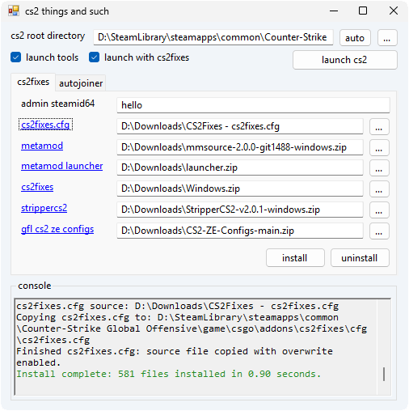

A simple Windows utility to automate some things I find tedious to interop. This handles the main 4 "modes" that the game can open in, while handling all the proper file operations to allow safe connections to VAC servers without erroring out after introducing/modifying game files.

This is a more lightweight version of a previous tool I made here: https://github.com/denialpan/cs2-misc-things



### Main features
- Streamline installing CS2Fixes locally for client.
- Swap between opening CS2 Workshop Tools or the vanilla game, with CS2Fixes loaded for either.
- Server auto joiner - auto connect to a CS2 server with configurable attempt intervals.

### CLI arguments
```
-gui          Launch the graphical interface.
-vanilla      Launch CS2 without CS2Fixes or Workshop Tools.
-tools        Launch CS2 Workshop Tools.
-cs2fixes     Launch CS2 with CS2Fixes.
-autojoiner   Launch normal CS2 and run the Autojoiner.
-ip <host>    Autojoiner server IP address or hostname.
-port <port>  Autojoiner server port from 1 through 65535.
-name <name>  Player name used to detect a successful connection.
-h, --help    Show this help text.
```

### Requirements
- Windows with .NET 4.8 (preinstalled on most Windows machines)
- Metamod: https://www.metamodsource.net/
- Metamod Launcher: https://github.com/Poggicek/metamod-launcher
- CS2Fixes: https://github.com/Source2ZE/CS2Fixes
- StripperCS2: https://github.com/Source2ZE/StripperCS2/
- GFL CS2 ZE Configs: https://github.com/gflze/CS2-ZE-Configs/
- admins.jsonc: https://pastebin.com/Ha83AvNw
- cs2fixes.cfg: https://pastebin.com/NUNWgZAY

### Credits
Guide to offline ZE maps: <https://www.youtube.com/watch?v=lJW8SSoDsbo>